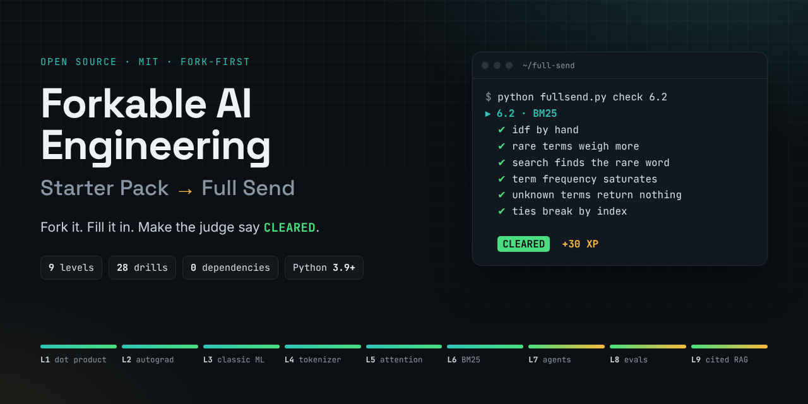

# Forkable AI Engineering: Starter Pack to Full Send

**Fork it. Fill it in. Make the judge say CLEARED.**

Twenty-eight drills that take you from a dot product to a retrieval engine that answers questions about this repository with citations. Plain Python, standard library only, one command to check your work.

[](https://github.com/suryakulshreshtha/Forkable-AI-Engineering-Starter-Pack-To-Full-Send/actions/workflows/fullsend.yml)


[](https://codespaces.new/suryakulshreshtha/Forkable-AI-Engineering-Starter-Pack-To-Full-Send)

## The deal

- **You get blueprints.** Every drill ships a brief, a judge (`test_drill.py`) and one worked answer (`reference.py`).
- **Your fork owns the answers.** Your `drill.py` files are created on your machine by `fullsend.py init` and are never part of upstream, so pulling new drills never collides with your work.
- **Zero dependencies.** Python 3.9 or newer and nothing else. No GPU, no API key, no `pip install`. It runs on an old laptop and in CI in seconds.
- **Proof, not vibes.** `PROGRESS.md` is written from the judge's verdicts, so your fork shows exactly what you built.

## Start in ninety seconds

```bash
# Fork this repo on GitHub first, then:
git clone https://github.com/<you>/Forkable-AI-Engineering-Starter-Pack-To-Full-Send.git
cd Forkable-AI-Engineering-Starter-Pack-To-Full-Send

python fullsend.py doctor   # checks Python, git and your setup
python fullsend.py init     # creates your drill.py files
python fullsend.py next     # shows the first drill to build
```

Use `python3` instead of `python` if that is what your system calls it.

## The loop

1. `python fullsend.py next` shows the drill and its brief.
2. Open that drill's `drill.py`. Every `TODO` marks code you write.
3. `python fullsend.py check 1.1` runs the judge. Read the failures; they are written to be useful. Prefer it automatic? `python fullsend.py watch 1.1` re-runs the judge every time you save.
4. Stuck? `python fullsend.py hint 1.1` reveals one hint at a time. Still stuck after an honest try? Read `reference.py`.
5. When the judge prints **CLEARED**, commit, then go again.

```text
▸ 1.3 · Downhill  levels/L1-numbers-that-learn/03-downhill/drill.py
  ✔ trajectory includes start and every step
  ✔ first step by hand
  ✘ momentum wins in a ravine - with the same learning rate, momentum should end much closer to the bottom
  · convergence step count - TODO: walk, measure the gradient's length, bail out on divergence

  2/8 passing  ·  stuck? python fullsend.py hint 1.3
```

## The map

Nine levels. Each one leans on the last, and the kit (below) hands you finished versions of earlier work so an old bug never haunts a new level.

<!-- board:start -->
_9 levels · 28 drills · 700 XP. Generated by `python fullsend.py build`._

| Level | Drills | XP |
| --- | --- | --- |
| [L1 · Numbers That Learn](levels/L1-numbers-that-learn/) | [1.1 Dot, Matvec, Matmul](levels/L1-numbers-that-learn/01-dot-and-matmul/) · [1.2 Slope Finder](levels/L1-numbers-that-learn/02-slope-finder/) · [1.3 Downhill](levels/L1-numbers-that-learn/03-downhill/) | 45 |
| [L2 · Tiny Autograd](levels/L2-tiny-autograd/) | [2.1 Scalar Graph](levels/L2-tiny-autograd/01-scalar-graph/) · [2.2 Neurons and Layers](levels/L2-tiny-autograd/02-neurons-and-layers/) · [2.3 Train XOR](levels/L2-tiny-autograd/03-train-xor/) | 85 |
| [L3 · Classic ML, No Excuses](levels/L3-classic-ml-no-excuses/) | [3.1 Line Fit](levels/L3-classic-ml-no-excuses/01-line-fit/) · [3.2 Logistic Classifier](levels/L3-classic-ml-no-excuses/02-logistic-classifier/) · [3.3 Honest Metrics](levels/L3-classic-ml-no-excuses/03-honest-metrics/) | 55 |
| [L4 · Language From Scratch](levels/L4-language-from-scratch/) | [4.1 BPE Tokenizer](levels/L4-language-from-scratch/01-bpe-tokenizer/) · [4.2 Bigram Language Model](levels/L4-language-from-scratch/02-bigram-lm/) · [4.3 Co-occurrence Vectors](levels/L4-language-from-scratch/03-cooccurrence-vectors/) | 80 |
| [L5 · Attention Is Weighted Averages](levels/L5-attention-is-weighted-averages/) | [5.1 Softmax and Friends](levels/L5-attention-is-weighted-averages/01-softmax-and-friends/) · [5.2 Self-Attention](levels/L5-attention-is-weighted-averages/02-self-attention/) · [5.3 Decoding Knobs](levels/L5-attention-is-weighted-averages/03-decoding-knobs/) | 70 |
| [L6 · Retrieval That Doesn't Lie](levels/L6-retrieval-that-doesnt-lie/) | [6.1 Chunker](levels/L6-retrieval-that-doesnt-lie/01-chunker/) · [6.2 BM25](levels/L6-retrieval-that-doesnt-lie/02-bm25/) · [6.3 Rank Fusion and Recall](levels/L6-retrieval-that-doesnt-lie/03-rank-fusion/) | 75 |
| [L7 · Agents Without Magic](levels/L7-agents-without-magic/) | [7.1 Tool Registry](levels/L7-agents-without-magic/01-tool-registry/) · [7.2 Agent Loop](levels/L7-agents-without-magic/02-agent-loop/) · [7.3 Retry and Budget](levels/L7-agents-without-magic/03-retry-and-budget/) | 85 |
| [L8 · Ship It](levels/L8-ship-it/) | [8.1 Eval Harness](levels/L8-ship-it/01-eval-harness/) · [8.2 Response Cache](levels/L8-ship-it/02-response-cache/) · [8.3 JSON Wrangler](levels/L8-ship-it/03-json-wrangler/) | 80 |
| [L9 · Full Send](levels/L9-full-send/) | [9.1 Ingest](levels/L9-full-send/01-ingest/) · [9.2 Retrieve](levels/L9-full-send/02-retrieve/) · [9.3 Cited Answers](levels/L9-full-send/03-cited-answers/) · [9.4 Self-Eval](levels/L9-full-send/04-self-eval/) | 125 |
<!-- board:end -->

## Commands

| Command | What it does |
| --- | --- |
| `python fullsend.py init` | Create your `drill.py` files. Never overwrites existing ones. |
| `python fullsend.py next` | The first drill you have not cleared, with its brief. |
| `python fullsend.py check <drill>` | Run the judge on your `drill.py`. A drill is `1.2`, `L1/02`, a slug like `slope-finder`, or a folder path. |
| `python fullsend.py watch <drill>` | Re-run the judge every time you save `drill.py`. Add `--exit-on-clear` to stop once it is cleared. |
| `python fullsend.py hint <drill> [n\|all]` | One hint at a time, from gentle to nearly-the-answer. |
| `python fullsend.py status [--json]` | The whole board: cleared, in progress, untouched. `--json` is for scripts. |
| `python fullsend.py card [--badge]` | Write `PROGRESS.md` for your fork. `--badge` also writes `progress-badge.json` for a live README badge. |
| `python fullsend.py sync [--dry-run]` | Pull new drills and fixes from upstream into your fork, then create any new `drill.py` files. |
| `python fullsend.py reset <drill>` | Back up your `drill.py` and start that drill fresh. |
| `python fullsend.py doctor` | Check Python, git, files and your `upstream` remote. |

Maintainers also get `build` (regenerate READMEs from drill docstrings), `verify` (every reference passes, every stub fails cleanly, docs are current) and `new` (scaffold a drill). The runner has its own tests: `python -m unittest discover -s tests`. See [CONTRIBUTING.md](CONTRIBUTING.md).

## Anatomy of a drill

```text
levels/L6-retrieval-that-doesnt-lie/02-bm25/
├── README.md        generated from the docstring in reference.py
├── reference.py     one worked answer; its docstring is the brief, the hints live there too
├── test_drill.py    the judge: every test_ function receives your module as `m`
└── drill.py         yours, created by `fullsend.py init` (not in upstream)
```

A drill is authored as a single `reference.py`. Code the learner should write sits between `# >>> fullsend: label` and `# <<< fullsend`; `init` turns each marked block into a `TODO` plus `raise NotImplementedError`. One source of truth, no drift between stubs and answers.

## The kit

`kit/` holds finished versions of things earlier drills ask you to build: linear algebra, autograd, neurons, softmax, BM25, the tool registry, plus a scripted fake language model for the agent level. Later drills import from it. Read a kit module after you clear the matching drill.

## The capstone: PocketRAG

Level 9 assembles a question-answering tool for this repository from your own code: ingest the Markdown, chunk it, rank with BM25, answer only from sentences you can cite, and refuse when the docs are silent.

```bash
python levels/L9-full-send/app.py "how do I pull new drills into my fork?"
python levels/L9-full-send/app.py --eval        # grade it against golden.json
python levels/L9-full-send/app.py --eval --min-score 0.9   # exit 1 below 90%, for CI
python levels/L9-full-send/app.py --reference "what does verify check?"   # see the reference version
```

## Learning with an AI assistant

Coding assistants are good tutors and terrible ghostwriters. [COACH.md](COACH.md) is a ready-made instruction file that tells an assistant to run the judge, explain failures and escalate hints, without writing your drills for you. The repository also ships [AGENTS.md](AGENTS.md), and a `CLAUDE.md` that points to it, so assistants that read those files pick up the coaching rules with no setup.

## More

- [FORK-ME.md](FORK-ME.md): forking, saving progress, staying in sync, showing it off
- [COACH.md](COACH.md): rules for AI tutors
- [CONTRIBUTING.md](CONTRIBUTING.md): writing new drills
- [ROADMAP.md](ROADMAP.md): what comes next
- [ORIGINALITY.md](ORIGINALITY.md): provenance, credits and how this repo stays clean

## License

This project uses the MIT license, so you can fork it, teach with it and remix it. The full text is in [LICENSE](LICENSE).
